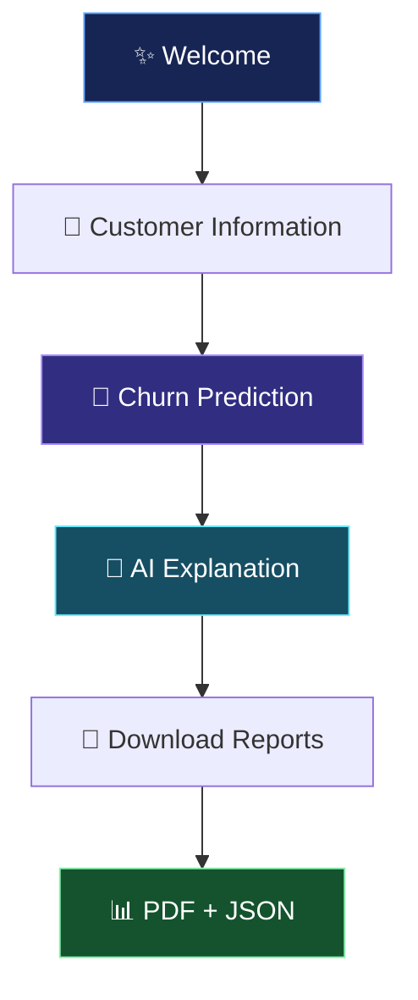

# Customer-Churn-Predictor
# 📡 ChurnSense AI — Intelligent Customer Retention

<p align="center">
  
  
  
  
  
</p>

<p align="center">
  <strong>Predict customer churn. Understand the risk. Discover smarter retention opportunities.</strong>
</p>

---

## ✨ Overview

**ChurnSense AI** is an interactive machine learning application that estimates how likely a telecom customer is to leave a service provider.

Instead of returning only a prediction, it helps users understand the factors influencing the model's estimate, explore potential retention actions, and export a professional customer report.

The application combines a trained machine learning pipeline, explainable AI, probability calibration, data validation, and automated PDF/JSON reporting in one workflow.

> 💡 **The mission:** Turn customer data into understandable predictions that can support better retention decisions.

## 🎬 Explore the five-step journey



### 🧭 Five interactive steps

| Step | What happens |
|---|---|
| ✨ Welcome | Start the application and train the model if needed |
| 👤 Customer Information | Enter customer details or load an example |
| 🔮 Prediction | Estimate churn probability and risk level |
| 🧠 Explanation | Explore factors that raised or lowered the model score |
| 📄 Download Report | Generate a PDF report and a matching JSON file |

## 🚀 Key features

- **🔮 Churn probability estimation** — predict the likelihood of a customer leaving.
- **🧠 Explainable AI** — use SHAP to identify the strongest contributing input factors.
- **🎯 Retention suggestions** — show rule-based actions associated with the factors identified by the model.
- **📊 Model comparison** — evaluate Logistic Regression, Random Forest, Extra Trees, and Gradient Boosting.
- **🎚️ Probability calibration** — use Platt scaling to improve probability quality.
- **📦 Batch predictions** — score customer records from CSV or Excel files.
- **🛡️ Input validation** — report invalid rows rather than silently filling or scoring them.
- **📄 PDF and JSON exports** — produce downloadable, consistent reports.
- **🧪 Automated testing** — validate core functionality and the complete five-step Streamlit workflow.

## 📈 Model performance

The following results come from the project's reported held-out test evaluation on 1,409 customers.

| Metric | Reported result |
|---|---:|
| ROC-AUC | **0.8384** |
| Accuracy | **76.2%** |
| Precision | **53.6%** |
| Recall | **75.1%** |
| F1-score | **62.6%** |
| Brier score after calibration | **0.1378** |
| Log loss after calibration | **0.4234** |

<details>
<summary><strong>🔬 Model selection and evaluation details</strong></summary>

Four candidate models were compared using five-fold cross-validation on the development set.

| Model | Development CV ROC-AUC |
|---|---:|
| Logistic Regression | 0.842 |
| Random Forest | 0.839 |
| Extra Trees | 0.838 |
| Gradient Boosting | 0.8423 |

Gradient Boosting was selected based on the highest reported cross-validated ROC-AUC.

The dataset was split using a stratified 80/20 split. Preprocessing and model fitting used only development data. The final test set was evaluated separately.

Probability calibration and threshold selection used development-set out-of-fold predictions, not the test set.

**Important:** The results above are the project's reported metrics. Run the included training and evaluation code to reproduce them in your own environment.

</details>

## 🧠 How the AI works

```mermaid
flowchart LR
    A["📂 Telco Dataset"] --> B["🧹 Validate Data"]
    B --> C["🔀 Stratified Split"]
    C --> D["⚙️ Preprocessing"]
    D --> E["🤖 Compare Models"]
    E --> F["🎯 Select Model"]
    F --> G["📏 Calibrate Probabilities"]
    G --> H["🔮 Customer Prediction"]
    H --> I["🧠 SHAP Explanation"]
    I --> J["📄 PDF / JSON Report"]
```



### The pipeline

1. Load and validate the customer churn dataset.
2. Exclude `customerID` from predictive features.
3. Split the dataset into development and held-out test sets.
4. Fit imputation, encoding, scaling, and models using development data only.
5. Compare four models using cross-validated ROC-AUC.
6. Select the decision threshold using out-of-fold development predictions.
7. Fit probability calibration without using test labels for tuning.
8. Generate predictions, SHAP-based explanations, and reports.

SHAP explanations show how inputs influence the model's estimate. They do **not** prove that a factor caused a customer to leave.

## 📂 Dataset

**IBM Telco Customer Churn**

- **Customers:** 7,043
- **Columns:** 21
- **Target:** `Churn`
- **Task:** Binary classification — `Yes` or `No`

Place the CSV in the following location:

```text
data/
└── Telco-Customer-Churn.csv
```

Dataset sources:

- [IBM Sample Data Repository](https://community.ibm.com/community/user/businessanalytics/blogs/steven-macko/2019/07/31/telco-customer-churn-1113)
- [Kaggle — IBM Telco Customer Churn](https://www.kaggle.com/datasets/blastchar/telco-customer-churn)

The dataset is not fabricated by the application. If the CSV is missing, training stops with a clear error.

## ⚙️ Installation and setup

### Requirements

- Python 3.10 or newer, subject to dependency compatibility
- pip
- Git (optional)
- The IBM Telco Customer Churn CSV file

### 🪟 Windows — PowerShell

```powershell
git clone YOUR_GITHUB_REPOSITORY_URL
cd customer-churn-project

python -m venv .venv
.\.venv\Scripts\Activate.ps1

python -m pip install --upgrade pip
python -m pip install -r requirements.txt
```

Replace `YOUR_GITHUB_REPOSITORY_URL` with your actual repository URL. If the project is already on your computer, open PowerShell inside the project folder and skip cloning.

### 🍎 macOS / 🐧 Linux

```bash
python3 -m venv .venv
source .venv/bin/activate

python -m pip install --upgrade pip
python -m pip install -r requirements.txt
```

## ▶️ Run the application

From the project root, activate your virtual environment and run:

```bash
python -m streamlit run app.py
```

Open **http://localhost:8501** in your browser.

If port 8501 is already in use:

```bash
python -m streamlit run app.py --server.port 8502
```

On the Welcome step, select **Train model** if no trained model exists. Training requires the dataset in `data/`.

## 📦 Batch scoring

Need to evaluate more than one customer? Use the **Batch file** option in the sidebar.

1. Download the sample CSV template.
2. Fill it with customer records.
3. Upload a CSV or Excel file.
4. Review validation errors, if any.
5. Download the scored results and batch report.

| Capability | Limit or behavior |
|---|---|
| File size | Up to 5 MB |
| Rows per upload | Up to 20,000 |
| Invalid records | Reported with row numbers and not scored |
| Main factors | Up to three SHAP-based contributing inputs per valid row |
| Downloads | Scored CSV, validation errors when applicable, PDF batch report |

Uploaded batch data stays in the current application session and is not intentionally saved to disk by the batch workflow.

## 📄 Reports and saved files

After a prediction, the application can generate:

```text
reports/
├── <report-id>.pdf
└── <report-id>.json
```

The PDF is designed for human review, while the JSON supports programmatic use and downstream integrations.

Both formats are generated from the same report data to keep the prediction and explanation consistent.

Generated models, metrics, reports, and the local dataset are gitignored.

## 🧪 Run tests

```powershell
python -m pytest tests.py -q
```

The project's last reported test run was **37 passed, no skips** on Windows with Python 3.13.5.

The test suite covers:

- Data loading and validation
- Leakage-aware data splitting
- Model comparison
- Prediction and probability output
- SHAP explanations
- Retention-action rules
- PDF and JSON consistency
- The five-step Streamlit workflow

Run the command locally to confirm the current code and environment pass the tests.

## 🗂️ Project structure

```text
customer-churn-project/
│
├── app.py                 # Streamlit application
├── model.py               # Training, prediction and explanations
├── utils.py               # Form defaults and retention rules
├── report.py              # PDF and JSON report generation
├── tests.py               # Automated tests
├── requirements.txt       # Python dependencies
│
├── data/                  # Local dataset (not committed)
├── models/                # Trained pipeline and metrics
├── reports/               # Generated customer reports
└── legacy/                # Earlier application implementation
```

## ⚠️ Limitations and responsible use

- The dataset represents one telecom business and may not generalize to other providers.
- The model does not include usage patterns, support tickets, complaints, or competitor information.
- A predicted probability is an estimate, not a guarantee.
- Calibration remains imperfect; review reliability metrics before interpreting scores as real-world frequencies.
- Retention actions are rule-based suggestions, not proof of causal impact.
- Predictions should support human decisions, not automatically trigger punitive customer treatment.

For production deployment, evaluate performance on recent, representative customer data and monitor drift, calibration, privacy, fairness, and business outcomes.

## 🛣️ Future improvements

- Interactive churn-risk and customer-segment dashboard
- Model monitoring and data-drift reports
- Business-impact evaluation of retention campaigns
- Additional model calibration and subgroup analysis
- Deployment with authentication and secure data handling
- External validation on independently sourced telecom datasets

## 👨‍💻 Built with

<p align="center">
  
  
  
  
</p>

---

<p align="center">
  <strong>📡 ChurnSense AI</strong><br/>
  <em>Understand the risk. Explain the prediction. Support smarter retention.</em>
</p>
